# FLAAP (Python) 검증 보고서

Generated 2026-11-27 06:43 by `validation/report.py`.

## 0. 검증 원칙과 요약

- 각 장의 제목은 **무엇을 검증했는지 (해석 기능)** 이다. Goland 날개, AGARD 445.6 등 사례는 그 아래 항목이다.
- 비교 기준 우선순위: **1순위 실험 -> 2순위 독립된 다른 해석/코드 -> 3순위 해석해**. 상위 기준이 없으면 그 사실과 이유를 적는다.
- 코드 내부 비교 (극한 일치, 해법 간 일치, 입력 경로 왕복) 는 **자기일관성** 으로 따로 표시하며 검증 근거로 세지 않는다.

| 장 | 검증 대상 | 1순위 실험 | 2순위 타 해석 | 3순위 해석해 | 대표 결과 |
|---|---|---|---|---|---|
| 1 | 구조 고유진동 해석 검증 (판·쉘·보·고체 FE) | AGARD 445.6 진동수 | Leissa, Yates FE | Goland 보, Timoshenko | 실험 대비 -1.6~+5.0 %; 해석해 대비 <= 1.4 % (tet4 제외) |
| 2 | 선형 DLM 플러터 검증 (아음속, DLM + PK) | AGARD 445.6 (M<=0.9) | Goland 3-D 문헌 5건, Fortran | 없음 | 실험 대비 +1.2~+3.3 %; 타 해석 평균 대비 -1.3 % |
| 3 | 스트립 이론 (Theodorsen) 플러터 검증 | 없음 | Goland 1945, Patil 2001 | - | V_f -0.2 %, w_f -0.9 % |
| 4 | TSD 천음속 플러터 검증 (비선형 TSD 평균류 + 시간선형화 비정상 해 + PK) | AGARD 445.6 (M 0.5-0.96) | 미비교 | - | 천음속 +0.2 / -3.5 % (DLM +10.6 / +8.6 %) |
| 5 | 양력 TSD 평균류 검증 (받음각·캠버, 충격파 위치) | 미비교 (공백) | AGARD-AR-211 Euler | Helmbold | 충격파 x/c 0.585 vs Euler 0.62 |
| 6 | 초음속 공력·플러터 검증 (Mach box, piston theory) | AGARD 445.6 (M 1.07/1.14) | Dowell 패널 플러터 | Ackeret, Garrick-Rubinow 등 | 실험 대비 +8.5 / +13.9 %; 해석해 < 1.2 % |
| 7 | VLM / UVLM 공력 및 UVLM 플러터 검증 | 없음 | Murua 2012 (Goland) | Helmbold, Wagner, Theodorsen 등 | 167.0 m/s vs Murua UVLM 165.0 m/s (+1.2 %) |
| 8 | 조종면 프리플레이 비선형 LCO 검증 | 미비교 (공백) | Vasconcellos 2016 V_f | 없음 | V_f 9.23 m/s vs 9.2 m/s |
| 9 | 공력서보탄성 (ASE) 플러터 억제·돌풍하중 완화 — 자기일관성 검사 | 없음 | 없음 | 없음 | 자기일관성만 |
| 10 | 돌풍 응답 검증 (1-cos 이산 돌풍) — 자기일관성 검사 | 없음 | 없음 | 없음 | TD vs FD 일치 |
| 11 | 정적 공탄성 트림·기동하중 — 자기일관성 검사 | 없음 | 없음 | 없음 | 자기일관성만 |

## 1. 구조 고유진동 해석 검증 (판·쉘·보·고체 FE)

**검증 대상:** `flaap.structures`의 MITC4 판, DKT/Allman 쉘, Euler-Bernoulli 보, hex8/tet10/tet4 고체 요소로 구한 고유진동수·모드형상 (플러터 해석의 구조 입력).

**비교 기준 (우선순위 순):**

- **1순위 실험** — AGARD 445.6 weakened model 3 측정 고유진동수 (Yates 1987, NASA TM-100492).
- **2순위 타 해석** — Yates (1987) FE 모델 진동수; Leissa (1973) CFFF 판 고유치 (Ritz 해석).
- **3순위 해석해** — Goland (1945) 보 정확해; Timoshenko 보 이론 (고체 요소 보).
- **자기일관성 (검증 근거 아님)** — 강체 모드, OpenRadioss/ANSYS/CalculiX/gmsh/STL/STEP 입력 경로 왕복.

**판정:** 실험 대비 MITC4 판 진동수 오차 +0.0 / +5.0 / +0.8 / -1.6 % (1차 굽힘/1차 비틀림/2차 굽힘/2차 비틀림; 같은 실험 대비 Yates FE 모델 +0.2 / -4.6 / -7.1 %). Leissa 대비 16x16 쉘 최대 0.61 %, Goland 정확해 대비 보 최대 0.15 %, Timoshenko 대비 hex8 20x2x2 최대 1.4 %, tet10 16x2x2 최대 0.9 %, tet4 40x4x4 28 % (선형 사면체의 잠김: tet10 사용 권장).

<!-- summary | 구조 고유진동 해석 검증 (판·쉘·보·고체 FE) | AGARD 445.6 진동수 | Leissa, Yates FE | Goland 보, Timoshenko | 실험 대비 -1.6~+5.0 %; 해석해 대비 <= 1.4 % (tet4 제외) -->

### 1.1 [1순위 실험] AGARD 445.6 판 날개 고유진동수 (MITC4 판 16x16)

재료: Kolonay (1996) 등가 직교이방성 물성 (진동수 맞춤 보정 없음).

| 진동수 [Hz] | 1차 굽힘 | 1차 비틀림 | 2차 굽힘 | 2차 비틀림 |
|---|---|---|---|---|
| **실험 (Yates 1987)** | 9.60 | 38.10 | 50.70 | 98.50 |
| FLAAP MITC4 16x16 | 9.60 | 40.01 | 51.10 | 96.96 |
| FLAAP 오차 | +0.0 % | +5.0 % | +0.8 % | -1.6 % |
| (타 해석) Yates FE 모델 | 9.60 | 38.17 | 48.35 | 91.54 |
| Yates FE 오차 | +0.0 % | +0.2 % | -4.6 % | -7.1 % |

### 1.2 [2순위 타 해석] 직사각형 외팔 판 (CFFF, a/h = 100) 고유치: Leissa (1973)

lambda = omega a^2 sqrt(rho h / D).

| 요소 / 격자 | lambda1 | lambda2 | lambda3 | lambda4 | lambda5 |
|---|---|---|---|---|---|
| **Leissa (1973)** | 3.492 | 8.525 | 21.430 | 27.330 | 31.110 |
| quad4 8x8 | 3.480 (-0.34 %) | 8.550 (+0.30 %) | 22.051 (+2.90 %) | 27.865 (+1.96 %) | 31.928 (+2.63 %) |
| quad4 16x16 | 3.473 (-0.54 %) | 8.513 (-0.14 %) | 21.465 (+0.17 %) | 27.349 (+0.07 %) | 31.169 (+0.19 %) |
| tri3 8x8 | 3.468 (-0.68 %) | 8.544 (+0.22 %) | 21.620 (+0.89 %) | 27.664 (+1.22 %) | 31.624 (+1.65 %) |
| tri3 16x16 | 3.471 (-0.61 %) | 8.516 (-0.10 %) | 21.371 (-0.28 %) | 27.320 (-0.04 %) | 31.131 (+0.07 %) |

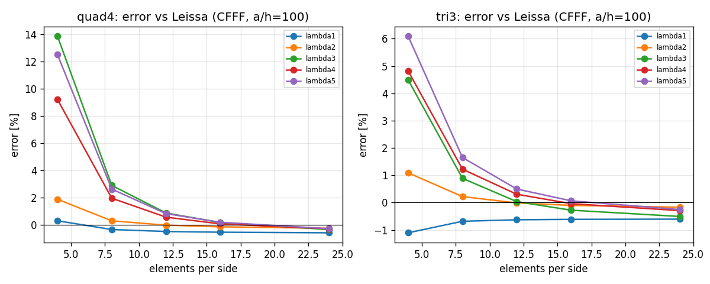

### 1.3 [3순위 해석해] 보: Goland (1945) 정확해, Timoshenko 보 이론 (고체 요소)

| Goland 날개 모드 | FLAAP 보 FE [rad/s] | 정확해 (Goland 1945) [rad/s] | 오차 |
|---|---|---|---|
| 1 | 48.15 | 48.13 | +0.05 % |
| 2 | 95.73 | 95.76 | -0.04 % |
| 3 | 244.15 | 243.79 | +0.15 % |
| 4 | 348.01 | 347.65 | +0.10 % |

정확해 수치: Savino et al., *Energies* 14 (2021) Table 2.

강철 외팔 보 (고체 요소) vs Timoshenko 보 이론:

| case | quantity | FLAAP | Timoshenko | err % | notes |
|---|---|---|---|---|---|
| hex8 20x2x2 | f1 [Hz] (bend-z) | 33.634 | 33.379 | +0.765 | euler_bernoulli 33.42, dofs 567 |
| hex8 20x2x2 | f2 [Hz] (bend-y) | 50.349 | 49.99 | +0.718 | euler_bernoulli 50.13, dofs 567 |
| hex8 20x2x2 | f3 [Hz] (bend-z) | 210.62 | 207.63 | +1.439 | euler_bernoulli 209.4, dofs 567 |
| tet10 10x2x2 | f1 [Hz] (bend-z) | 33.787 | 33.379 | +1.224 | euler_bernoulli 33.42, dofs 1575 |
| tet10 10x2x2 | f2 [Hz] (bend-y) | 50.528 | 49.99 | +1.076 | euler_bernoulli 50.13, dofs 1575 |
| tet10 10x2x2 | f3 [Hz] (bend-z) | 211.34 | 207.63 | +1.784 | euler_bernoulli 209.4, dofs 1575 |
| tet10 16x2x2 | f1 [Hz] (bend-z) | 33.635 | 33.379 | +0.768 | euler_bernoulli 33.42, dofs 2475 |
| tet10 16x2x2 | f2 [Hz] (bend-y) | 50.323 | 49.99 | +0.666 | euler_bernoulli 50.13, dofs 2475 |
| tet10 16x2x2 | f3 [Hz] (bend-z) | 209.49 | 207.63 | +0.894 | euler_bernoulli 209.4, dofs 2475 |
| tet4 40x4x4 | f1 [Hz] (bend-z) | 42.78 | 33.379 | +28.166 | euler_bernoulli 33.42, dofs 3075 |
| tet4 40x4x4 | f2 [Hz] (bend-y) | 59.312 | 49.99 | +18.649 | euler_bernoulli 50.13, dofs 3075 |
| tet4 40x4x4 | f3 [Hz] (bend-z) | 265.75 | 207.63 | +27.989 | euler_bernoulli 209.4, dofs 3075 |

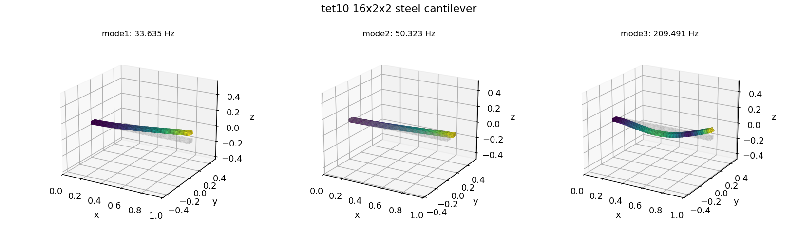

### 1.4 [자기일관성 (검증 근거 아님)] 강체 모드와 입력 경로 (외부 FE 결과·형상 파일)

기준값은 위 1.2/1.3과 같은 Leissa/Timoshenko 값 또는 원본 FE 결과 자체 (읽기 왕복).

**자유-자유 강체 모드 (0 Hz 이어야 함)**

| case | quantity | FLAAP | ref | err % | notes |
|---|---|---|---|---|---|
| free plate quad4 | max rigid f [Hz] | 0.0017865 |  |  | first_elastic 33.25 |
| free plate tri3 | max rigid f [Hz] | 0.0032238 |  |  | first_elastic 33.23 |
| free beam hex8 | max rigid f [Hz] | 0.0019203 |  |  | first_elastic 853.8 |
| free beam tet10 | max rigid f [Hz] | 0.001276 |  |  | first_elastic 835.1 |
| free beam tet4 | max rigid f [Hz] | 0.0022049 |  |  | first_elastic 1724 |

**OpenRadioss 입력 덱 -> FLAAP 고유해석**

| case | quantity | FLAAP | ref | err % | notes |
|---|---|---|---|---|---|
| plate_cantilever_0000.rad | lambda1 | 3.4731 | 3.492 | -0.541 |  |
| plate_cantilever_0000.rad | lambda2 | 8.5127 | 8.525 | -0.145 |  |
| plate_cantilever_0000.rad | lambda3 | 21.465 | 21.43 | +0.165 |  |
| plate_cantilever_0000.rad | lambda4 | 27.349 | 27.33 | +0.071 |  |
| plate_cantilever_0000.rad | lambda5 | 31.169 | 31.11 | +0.190 |  |
| plate_tria_0000.rad | lambda1 | 3.4706 | 3.492 | -0.613 |  |
| plate_tria_0000.rad | lambda2 | 8.5164 | 8.525 | -0.101 |  |
| plate_tria_0000.rad | lambda3 | 21.371 | 21.43 | -0.277 |  |
| plate_tria_0000.rad | lambda4 | 27.32 | 27.33 | -0.038 |  |
| plate_tria_0000.rad | lambda5 | 31.131 | 31.11 | +0.066 |  |
| beam_brick_0000.rad | f1 [Hz] (bend-z) | 33.634 | 33.379 | +0.765 |  |
| beam_brick_0000.rad | f2 [Hz] (bend-y) | 50.349 | 49.99 | +0.718 |  |
| beam_brick_0000.rad | f3 [Hz] (bend-z) | 210.62 | 207.63 | +1.439 |  |
| beam_brick_0000.rad | f4 [Hz] (bend-y) | 312.69 | 308.16 | +1.471 |  |
| beam_tetra10_0000.rad | f1 [Hz] (bend-z) | 33.717 | 33.379 | +1.012 |  |
| beam_tetra10_0000.rad | f2 [Hz] (bend-y) | 50.433 | 49.99 | +0.886 |  |
| beam_tetra10_0000.rad | f3 [Hz] (bend-z) | 210.39 | 207.63 | +1.329 |  |
| beam_tetra10_0000.rad | f4 [Hz] (bend-y) | 311.5 | 308.16 | +1.086 |  |

**ANSYS MAPDL/Workbench 결과 읽기 (원본 대비)**

| case | quantity | FLAAP | ref | err % | notes |
|---|---|---|---|---|---|
| MAPDL SET,LIST + PRNSOL U/ROT + CDB | max |df/f| [%] | 0.0010656 |  |  | min_mac 1, nmodes 6 |
| MAPDL PRNSOL,DOF (wrapped) | max |df/f| [%] | 6.4728e-11 |  |  | min_mac 1, nmodes 6 |
| MAPDL listing in mm-t units | max |df/f| [%] | 0.0010656 |  |  | min_mac 1, nmodes 6 |
| Workbench per-mode text (UZ) | max |df/f| [%] | 0.0010656 |  |  | min_mac 1, nmodes 6 |

**CalculiX .frd/.dat 읽기 (원본 대비) 및 플러터**

| case | quantity | FLAAP | ref | err % | notes |
|---|---|---|---|---|---|
| .frd long format + .dat (SI) | max |df/f| [%] | 1.0554e-06 |  |  | min_mac 1, nmodes 6 |
| .frd short format, mm-t-s, static step + 3 rigid modes | max |df/f| [%] | 0.00027005 |  |  | min_mac 1, nmodes 6 |
| PK flutter: .frd (mm-t-s) vs FLAAP plate FE | V_f [m/s] | 70.585 | 70.585 | +0.000 | f_hz 9.323, f_ref_hz 9.323 |

**gmsh 메셔 (.geo/.msh)**

| case | quantity | FLAAP | ref | err % | notes |
|---|---|---|---|---|---|
| .geo plate, transfinite 6x12 quad4 (Recombine) | max |df/f| [%] | 2.6149e-05 |  |  | nodes 91 |
| .msh (MSH 4.1) round trip | max |df/f| [%] | 2.6218e-05 |  |  |  |
| .geo OCC bar 1.0x0.10x0.02 m, tet10 | f1 [Hz] (Euler-Bernoulli) | 16.454 | 16.32 | +0.822 | nodes 3337 |
| PK flutter: gmsh .geo plate vs CalculiX .frd | V_f [m/s] | 70.585 | 70.585 | -0.000 | f_hz 9.323 |

**STL/STEP 형상 -> 자동 격자 -> 고유해석**

| case | quantity | FLAAP | ref | err % | notes |
|---|---|---|---|---|---|
| STL box tet10 h=0.03 | f1 [Hz] | 33.499 | 33.379 | +0.361 | nodes 1708 |
| STL box tet10 h=0.03 | f2 [Hz] | 50.133 | 49.99 | +0.287 | nodes 1708 |
| STL box tet10 h=0.03 | f3 [Hz] | 208.51 | 207.63 | +0.422 | nodes 1708 |
| STL box tet10 h=0.02 | f1 [Hz] | 33.488 | 33.379 | +0.329 | nodes 3917 |
| STL box tet10 h=0.02 | f2 [Hz] | 50.12 | 49.99 | +0.260 | nodes 3917 |
| STL box tet10 h=0.02 | f3 [Hz] | 208.34 | 207.63 | +0.342 | nodes 3917 |
| STEP box (mm) tet10 h=0.02 | f1 [Hz] | 33.492 | 33.379 | +0.340 | nodes 3836 |
| STEP box (mm) tet10 h=0.02 | f2 [Hz] | 50.123 | 49.99 | +0.267 | nodes 3836 |
| STEP box (mm) tet10 h=0.02 | f3 [Hz] | 208.37 | 207.63 | +0.354 | nodes 3836 |
| STL plate -> gmsh tri3 h=0.06 | lambda1 | 3.4718 | 3.492 | -0.577 | nodes 364 |
| STL plate -> gmsh tri3 h=0.06 | lambda2 | 8.5152 | 8.525 | -0.115 | nodes 364 |
| STL plate -> gmsh tri3 h=0.06 | lambda3 | 21.272 | 21.43 | -0.738 | nodes 364 |
| STL plate -> gmsh tri3 h=0.06 | lambda4 | 27.38 | 27.33 | +0.182 | nodes 364 |
| STL plate -> gmsh tri3 h=0.06 | lambda5 | 31.075 | 31.11 | -0.113 | nodes 364 |
| NACA wing solid tet10 | f1 [Hz] | 27.104 |  |  | nodes 7672 |
| NACA wing solid tet10 | f2 [Hz] | 127.33 |  |  | nodes 7672 |
| NACA wing solid tet10 | f3 [Hz] | 208.18 |  |  | nodes 7672 |
| NACA wing solid tet10 | f4 [Hz] | 229.28 |  |  | nodes 7672 |
| NACA wing solid tet4 | f1 [Hz] | 52.345 |  |  | nodes 1319 |
| NACA wing solid tet4 | f2 [Hz] | 210.2 |  |  | nodes 1319 |
| NACA wing solid tet4 | f3 [Hz] | 245.19 |  |  | nodes 1319 |
| NACA wing solid tet4 | f4 [Hz] | 455.06 |  |  | nodes 1319 |
| NACA wing shell tri3 t=3mm | f1 [Hz] | 34.218 |  |  | nodes 442 |
| NACA wing shell tri3 t=3mm | f2 [Hz] | 120.05 |  |  | nodes 442 |
| NACA wing shell tri3 t=3mm | f3 [Hz] | 162.53 |  |  | nodes 442 |
| NACA wing shell tri3 t=3mm | f4 [Hz] | 183.27 |  |  | nodes 442 |

**STL 날개 형상 -> tet10 모드 -> PK 플러터 (시연, 기준값 없음)**

| case | quantity | FLAAP | ref | err % | notes |
|---|---|---|---|---|---|
| STL wing tet10 | f1 [Hz] | 9.7726 |  |  |  |
| STL wing tet10 | f2 [Hz] | 45.925 |  |  |  |
| STL wing tet10 | f3 [Hz] | 75.222 |  |  |  |
| STL wing tet10 | f4 [Hz] | 83.733 |  |  |  |
| STL wing tet10 | f5 [Hz] | 116.58 |  |  |  |
| STL wing tet10 | f6 [Hz] | 191.54 |  |  |  |
| STL wing PK (M=0.3, sea level) | flutter V [m/s] | 160.92 |  |  | freq_hz 41.1 |

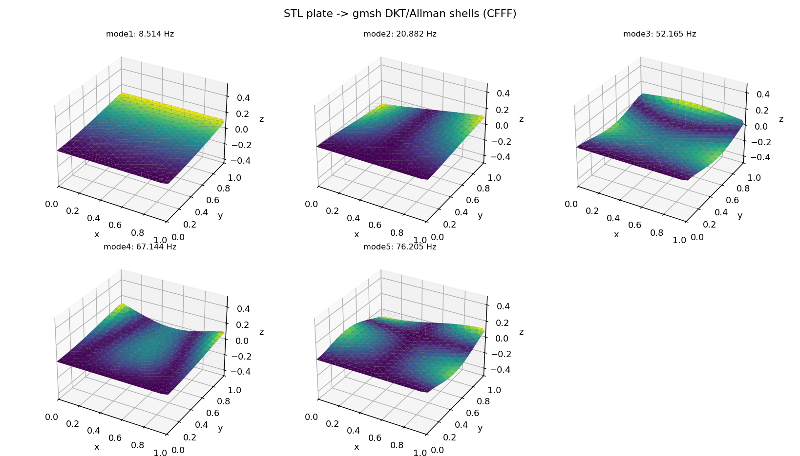

## 2. 선형 DLM 플러터 검증 (아음속, DLM + PK)

**검증 대상:** 이중격자법(DLM) 비정상 공력 + 스플라인 + PK 플러터 해석의 플러터 속도·진동수 (`aero_method dlm`, `mode pk`).

**비교 기준 (우선순위 순):**

- **1순위 실험** — AGARD 445.6 weakened model 3 플러터 경계 (Yates 1987), M 0.499-0.960.
- **2순위 타 해석** — Goland 날개 3-D 결과 (Murua 2012 UVLM, Wang 2006 UVLM/ZAERO, Savino 2021 DUST); 원본 Fortran FLAAP.exe (같은 입력 덱).
- **3순위 해석해** — 없음 — 3-D 비정상 양력면의 해석해는 없음 (2-D 극한은 3장 스트립 이론).
- **자기일관성 (검증 근거 아님)** — 같은 GAF 표에서 PK / K / p(Roger RFA) 해법 비교, DLM 격자 수렴.

**판정:** 아음속 선형 영역 (M <= 0.9) 실험 대비 FSI 오차 +1.2~+3.3 % (측정 진동수 사용). 천음속 M 0.954/0.960에서는 +10.6 / +8.6 %로 천음속 딥을 놓침 — 선형 이론의 한계이며 4장 TSD가 보완. Goland 3-D: 문헌 범위 163.8-174.3 m/s 안 (166.9 m/s, 평균 대비 -1.3 %).

<!-- summary | 선형 DLM 플러터 검증 (아음속, DLM + PK) | AGARD 445.6 (M<=0.9) | Goland 3-D 문헌 5건, Fortran | 없음 | 실험 대비 +1.2~+3.3 %; 타 해석 평균 대비 -1.3 % -->

### 2.1 [1순위 실험] AGARD 445.6 플러터 경계 (Yates 1987)

FSI, wf/wa는 b = 0.2794 m, omega_alpha = 239.3 rad/s 기준. 시험 질량비를 맞춤 (rho_eq = rho * m_model / m_test). 구조: 1.1의 MITC4 판 모드형상.

| Mach | FSI 실험 | FLAAP (측정 진동수) | 오차 % | FLAAP (FE 진동수) | 오차 % | wf/wa 실험 | wf/wa FLAAP |
|---|---|---|---|---|---|---|---|
| 0.499 | 0.4459 | 0.4512 | +1.2 | 0.4750 | +6.5 | 0.5353 | 0.6029 |
| 0.678 | 0.4174 | 0.4313 | +3.3 | 0.4537 | +8.7 | 0.4722 | 0.5459 |
| 0.901 | 0.3700 | 0.3749 | +1.3 | 0.3938 | +6.4 | 0.4225 | 0.4388 |
| 0.954 | 0.3059 | 0.3384 | +10.6 | 0.3551 | +16.1 | 0.3807 | 0.3940 |
| 0.960 | 0.3076 | 0.3341 | +8.6 | 0.3505 | +14.0 | 0.3648 | 0.3891 |

M > 1 점 (1.072, 1.141)은 DLM 적용 범위 밖 — 6장 초음속 Mach box에서 검증.

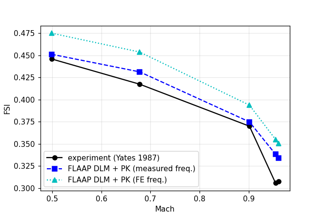

### 2.2 [2순위 타 해석] Goland 날개 3-D 플러터 (rho = 1.02 kg/m^3, 문헌 양력면/패널 해석)

| 출처 | 방법 | V_f [m/s] | f_f [Hz] |
|---|---|---|---|
| **FLAAP** | DLM 6x12, PK | 164.6 | 11.24 |
| **FLAAP** | DLM 10x20, PK | 166.9 | 11.12 |
| Murua et al. 2012 | UVLM (SHARP) | 165.0 | 10.98 |
| Wang et al. 2006 | UVLM | 163.8 |  |
| Wang et al. 2006 | ZAERO (DLM) | 174.3 |  |
| Savino et al. 2021 | DUST vortex lattice | 168.2 | 10.84 |
| Savino et al. 2021 | DUST surface panels | 174.2 | 11.06 |

문헌 범위 163.8-174.3 m/s (평균 169.1); FLAAP 164.6 / 166.9 m/s.

### 2.3 [2순위 타 해석] 원본 Fortran FLAAP.exe (Conyers 판 날개, 같은 입력 덱)

Python 레거시 스플라인 + DLM + PK vs Fortran `pk_results_mode*.dat` (진동수 Hz).

| mode | V [m/s] | g Fortran | g FLAAP-py | f Fortran | f FLAAP-py |
|---|---|---|---|---|---|
| 7 | 50 | -0.0399 | -0.0377 | 100.63 | 100.96 |
| 7 | 150 | +0.0316 | -0.4747 | 72.88 | 75.56 |
| 7 | 250 | -9.6304 | -1.0000 | 40.05 | 0.00 |
| 8 | 50 | -0.0239 | -0.0222 | 130.51 | 131.05 |
| 8 | 150 | +0.0290 | +0.0511 | 83.23 | 84.56 |
| 8 | 250 | -0.0771 | -0.0691 | 87.55 | 86.63 |
| 9 | 50 | -0.0218 | -0.0211 | 138.39 | 138.80 |
| 9 | 150 | -0.0552 | -0.0518 | 135.59 | 136.05 |
| 9 | 250 | -0.1279 | -0.1157 | 119.32 | 122.97 |
| 10 | 50 | -0.0203 | -0.0190 | 168.79 | 169.03 |
| 10 | 150 | -0.0646 | -0.0613 | 160.08 | 160.85 |
| 10 | 250 | -0.0959 | -0.0921 | 157.32 | 156.75 |

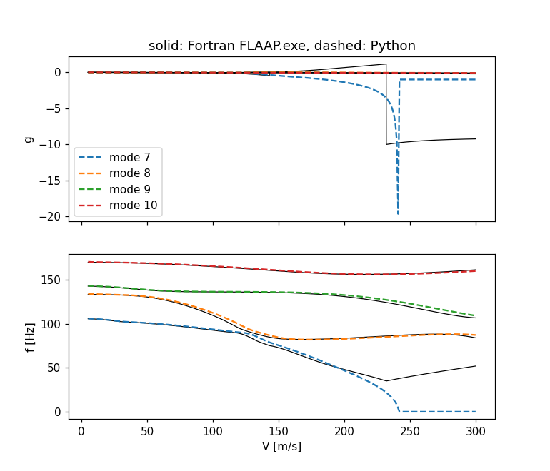

모드 8-10은 감쇠 수 %, 진동수 1-3 % 이내 일치. 약 120 m/s 이상에서 모드 7은 모드 8과 합체 영역에 들어가 (Fortran 파일 자체도 250 m/s에서 g = -9.6) 두 코드의 모드 추적 라벨이 달라짐. Fortran 출력에는 모드 7-10만 있어, Python이 예측한 저속 모드 2 불안정 (    flutter  mode  2  V =    21.258 m/s  f =   10.477 Hz (  65.829 rad/s)  k =  0.2362) 은 교차 확인할 수 없음.

### 2.4 [자기일관성 (검증 근거 아님)] 플러터 해법 간 비교와 격자 수렴 (Goland, rho = 1.225)

| 해법 (같은 DLM 6x12 GAF 표) | V_f [m/s] | w_f [rad/s] |
|---|---|---|
| PK | 153.3 | 70.7 |
| K (V-g) | 153.3 | 70.7 |
| p (Roger RFA, 4 lags) | 153.1 | 70.7 |

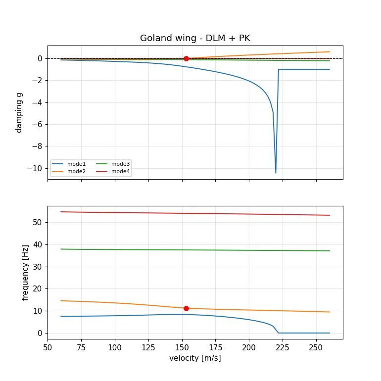

## 3. 스트립 이론 (Theodorsen) 플러터 검증

**검증 대상:** Theodorsen 2-D 비정상 공력을 날개 길이 방향 스트립에 적용한 플러터 해석 (`aero_method strip`).

**비교 기준 (우선순위 순):**

- **1순위 실험** — 없음 — Goland 날개는 해석용 기준 모델로 시험 데이터 없음.
- **2순위 타 해석** — Goland (1945) 스트립 이론 플러터 해, Patil, Hodges & Cesnik (2001).
- **3순위 해석해** — Theodorsen 함수 자체가 공력 모델 (별도 비교 불필요).
- **자기일관성 (검증 근거 아님)** — 없음.

**판정:** Goland (1945) 대비 V_f -0.2 %, w_f -0.9 %.

<!-- summary | 스트립 이론 (Theodorsen) 플러터 검증 | 없음 | Goland 1945, Patil 2001 | - | V_f -0.2 %, w_f -0.9 % -->

### 3.1 [2순위 타 해석] Goland 날개, rho = 1.225 kg/m^3

| 출처 | V_f [m/s] | w_f [rad/s] |
|---|---|---|
| **FLAAP 스트립 이론 + PK** | 137.0 | 70.0 |
| Goland (1945) | 137.2 | 70.7 |
| Patil, Hodges & Cesnik (2001) | 135.6 | 70.2 |

같은 모델에서 DLM (3-D 날개끝 효과 포함)은 2.4의 153 m/s로 스트립 이론보다 높음.

## 4. TSD 천음속 플러터 검증 (비선형 TSD 평균류 + 시간선형화 비정상 해 + PK)

**검증 대상:** `flaap.aero.tsd`: 두께에 의한 천음속 비선형 정상 평균류(충격파 포함) 위의 시간선형화 비정상 공력 (`aero_method tsd`) 으로 구한 플러터 경계, 특히 천음속 딥.

**비교 기준 (우선순위 순):**

- **1순위 실험** — AGARD 445.6 weakened model 3 (Yates 1987), M 0.499-0.960, NACA 65A004.
- **2순위 타 해석** — 미비교 — 문헌의 CAP-TSD/Euler 결과와의 정량 비교는 아직 없음.
- **3순위 해석해** — 해당 없음 (천음속 비선형 해석해 없음).
- **자기일관성 (검증 근거 아님)** — 두께 0 TSD ('TSD flat') = 선형 DLM 이어야 함.

**판정:** 천음속 M 0.954/0.960 실험 대비 TSD +0.2 / -3.5 % (같은 조건 DLM +10.6 / +8.6 %) — 천음속 딥 재현. 아음속 M 0.499/0.901은 +1.1 / -2.6 %. TSD flat vs DLM 최대 1.8 %.

<!-- summary | TSD 천음속 플러터 검증 (비선형 TSD 평균류 + 시간선형화 비정상 해 + PK) | AGARD 445.6 (M 0.5-0.96) | 미비교 | - | 천음속 +0.2 / -3.5 % (DLM +10.6 / +8.6 %) -->

### 4.1 [1순위 실험] AGARD 445.6 천음속 플러터 경계 (Yates 1987; 측정 진동수, FE 모드형상)

TSD 격자 51x20x22, NACA 65A004 두께.

| Mach | FSI 실험 | TSD | 오차 % | DLM | 오차 % | wf/wa 실험 | wf/wa TSD |
|---|---|---|---|---|---|---|---|
| 0.499 | 0.4459 | 0.4510 | +1.1 | 0.4512 | +1.2 | 0.5353 | 0.5930 |
| 0.901 | 0.3700 | 0.3604 | -2.6 | 0.3749 | +1.3 | 0.4225 | 0.4220 |
| 0.954 | 0.3059 | 0.3064 | +0.2 | 0.3383 | +10.6 | 0.3807 | 0.3653 |
| 0.960 | 0.3076 | 0.2970 | -3.5 | 0.3340 | +8.6 | 0.3648 | 0.3568 |

두께에 의한 천음속 평균류가 M 0.95 부근 플러터 속도를 낮춰, 선형 DLM이 놓치는 천음속 딥을 재현.

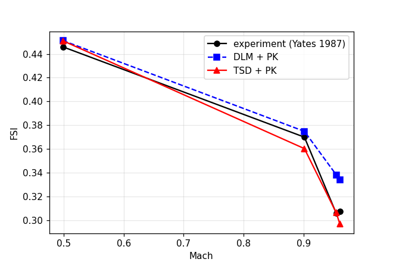

### 4.2 [자기일관성 (검증 근거 아님)] 두께 0 TSD vs DLM

| Mach | DLM | TSD flat | 차이 % |
|---|---|---|---|
| 0.499 | 0.4512 | 0.4513 | +0.0 |
| 0.901 | 0.3749 | 0.3699 | -1.3 |
| 0.954 | 0.3383 | 0.3326 | -1.7 |
| 0.960 | 0.3340 | 0.3280 | -1.8 |

## 5. 양력 TSD 평균류 검증 (받음각·캠버, 충격파 위치)

**검증 대상:** `flaap.aero.tsd_lifting`: 받음각/캠버가 있는 비선형 TSD 정상 해 — 윗면/아랫면 충격파 위치와 세기, 양력, 그리고 그 평균류 위의 플러터 (`tsd_alpha`, `tsd_camber`).

**비교 기준 (우선순위 순):**

- **1순위 실험** — 충격파 위치: 미비교 (실험 공백). NACA 0012 천음속 2-D 풍동 자료(예: Harris 1981, NASA TM-81927)는 점성·벽 보정이 섞여 있어 아직 비교하지 않음. 받음각이 있는 AGARD 445.6 플러터 실험은 없음 (alpha = 0 점만 Yates 1987, 4장).
- **2순위 타 해석** — AGARD-AR-211 (1985) 비점성 Euler 합의값, NACA 0012, M 0.8, alpha 1.25 deg.
- **3순위 해석해** — 아음속 선형 극한 양력 기울기: Helmbold 식.
- **자기일관성 (검증 근거 아님)** — alpha = 0이면 대칭 TSD와 동일, +-alpha 면 교환 대칭, 선형 TSD 극한.

**판정:** 같은 단면 cl = 0.35에서 윗면 충격파 x/c = 0.585 (Euler 0.62; TSD 충격파가 0.035 c 앞). Euler의 약한 아랫면 충격파는 TSD에서 alpha > 0.5 deg이면 사라짐. CL_alpha Helmbold 대비 -4.2 %. 모든 받음각 수렴: 예.

<!-- summary | 양력 TSD 평균류 검증 (받음각·캠버, 충격파 위치) | 미비교 (공백) | AGARD-AR-211 Euler | Helmbold | 충격파 x/c 0.585 vs Euler 0.62 -->

### 5.1 [1순위 실험] 실험 비교 없음

충격파 위치에 대한 실험 비교는 아직 없음 (위 비교 기준 참조). 받음각이 있는 AGARD 445.6의 플러터 결과(5.4)도 실험이 없는 경향 예측임.

### 5.2 [2순위 타 해석] NACA 0012, M = 0.8: AGARD-AR-211 Euler 대비

종횡비 16 직사각형 날개의 뿌리 단면 (준 2-D), 시위 방향 40점.

| alpha [deg] | CL | 뿌리 cl | 윗면 충격파 x/c | dCp 윗면 | 아랫면 충격파 x/c | 수렴 |
|---|---|---|---|---|---|---|
| 0 | 0.000 | 0.000 | 0.365 | 0.27 | 0.365 | y |
| 0.5 | 0.091 | 0.105 | 0.439 | 0.54 | 0.316 | y |
| 1 | 0.188 | 0.218 | 0.512 | 0.77 | - | y |
| 1.25 | 0.241 | 0.281 | 0.537 | 0.88 | - | y |
| 1.5 | 0.299 | 0.351 | 0.586 | 0.98 | - | y |
| 2 | 0.433 | 0.520 | 0.684 | 1.18 | - | y |
| **Euler (AR-211), alpha 1.25** | | **~0.35** | **~0.62** | | **~0.35 (약함)** | |

같은 단면 cl = 0.35 (alpha ~ 1.50 deg; 유한 날개 뿌리 단면은 내리흐름 때문에 같은 cl에 더 큰 alpha가 필요)에서 TSD 윗면 충격파 x/c = 0.585. 약한 아랫면 충격파는 TSD에서 alpha ~ 0.5 deg 이상에서 사라짐 (고전 TSD 계수, Ames 항 없음; 앞전 근처 얇은 날개 경계조건).

### 5.3 [3순위 해석해] 선형 극한 양력 기울기 (M 0.5, 평판, A = 8)

| | CL_alpha [1/rad] |
|---|---|
| FLAAP 양력 TSD | 5.229 |
| Helmbold | 5.457 |
| 오차 | -4.2 % |

### 5.4 [자기일관성 (검증 근거 아님)] 정확 일치 검사와 받음각 평균류 위 플러터 경향

| 검사 | 결과 |
|---|---|
| alpha = 0, 캠버 없음 vs 대칭 `TSDSolver` | max abs dphi 3.5e-16, GAF 상대차 3.5e-15 |
| alpha = +-1 deg: Cp 윗면(+) vs 아랫면(-) | 4.9e-15 (CL 반대칭 1.0e-15) |
| M 0.5 평판, alpha 1 deg vs 선형 (k = 0) TSD | 단면 cl 상대차 5.2e-05 |

AGARD 445.6, M = 0.954, 평균 받음각에 따른 플러터 (alpha = 0만 실험 있음):

| 평균 alpha [deg] | CL | FSI | wf/wa |
|---|---|---|---|
| 0 | -0.000 | 0.3064 (실험 0.3059) | 0.365 |
| 1 | 0.071 | 0.3034 | 0.363 |
| 2 | 0.143 | 0.2956 | 0.356 |

평균 받음각이 FSI를 낮춤 (-3.5 % at 2 deg): 윗면 충격파가 강해져 충격파 운동 하중이 불안정 쪽으로 기여.

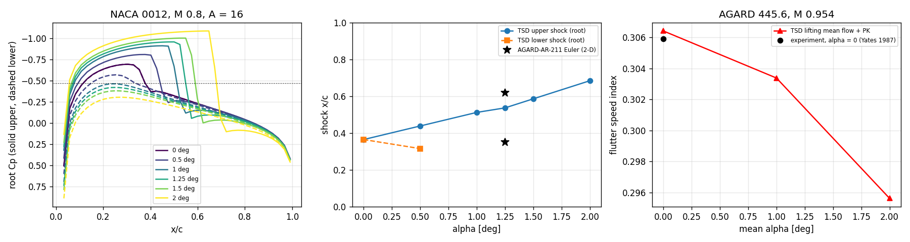

## 6. 초음속 공력·플러터 검증 (Mach box, piston theory)

**검증 대상:** `flaap.aero.supersonic` (`aero_method machbox | piston`): 초음속 정상/비정상 압력과 플러터.

**비교 기준 (우선순위 순):**

- **1순위 실험** — AGARD 445.6 weakened model 3, M 1.072 / 1.141 (Yates 1987).
- **2순위 타 해석** — 패널 플러터 임계 동압: Hedgepeth (1957) / Dowell (1975) 수렴 Galerkin 해.
- **3순위 해석해** — 정상 양력 기울기 (Ackeret, 초음속 날개끝, Stewart 삼각익), 2-D 진동 평판 (Garrick-Rubinow 적분), 2-모드 Galerkin 패널 식.
- **자기일관성 (검증 근거 아님)** — 없음.

**판정:** 실험 대비 Mach box (nx 80, 측정 진동수) FSI +8.5 / +13.9 % — M 1.07-1.14의 낮은 초음속에서 두께·점성을 뺀 선형 포텐셜 이론의 한계; piston theory는 이 Mach에서 적용 불가 (대부분 플러터 없음, 1차 4/M은 M 1.141에서 FSI 3.6배). 패널 플러터 타 해석 대비 최대 0.05 %, 해석해 대비 정상 양력 최대 1.23 %, Garrick-Rubinow 대비 최대 0.024 %.

<!-- summary | 초음속 공력·플러터 검증 (Mach box, piston theory) | AGARD 445.6 (M 1.07/1.14) | Dowell 패널 플러터 | Ackeret, Garrick-Rubinow 등 | 실험 대비 +8.5 / +13.9 %; 해석해 < 1.2 % -->

### 6.1 [1순위 실험] AGARD 445.6 초음속 플러터 경계 (Yates 1987)

```
6. AGARD 445.6 weakened model 3, supersonic points (PK, matched mass ratio,
   MITC4 16x16 FE mode shapes; DLM mesh 12x16 for the mode interpolation)
  natural frequencies: measured ([ 9.6 38.1 50.7 98.5] Hz)
       M method                        FSI  FSI exp      err   wf/wa     exp  time
   1.072 piston, Van Dyke             none   0.3201                   0.3623  0.4 s  (no flutter up to 1500 m/s)
   1.072 piston, 1st order 4/M        none   0.3201                   0.3623  0.4 s  (no flutter up to 1500 m/s)
   1.072 Mach box nx = 40           0.3485   0.3201    +8.9%  0.4011  0.3623  0.8 s
   1.072 Mach box nx = 80           0.3474   0.3201    +8.5%  0.3924  0.3623  1.2 s
   1.072 Mach box nx = 160          0.3524   0.3201   +10.1%  0.3943  0.3623  3.3 s
   1.141 piston, Van Dyke             none   0.4031                   0.4593  0.4 s  (no flutter up to 1500 m/s)
   1.141 piston, 1st order 4/M      1.4497   0.4031  +259.6%  1.2183  0.4593  0.4 s
   1.141 Mach box nx = 40           0.4442   0.4031   +10.2%  0.4889  0.4593  0.8 s
   1.141 Mach box nx = 80           0.4593   0.4031   +13.9%  0.4980  0.4593  1.2 s
   1.141 Mach box nx = 160          0.4571   0.4031   +13.4%  0.4932  0.4593  3.6 s

  natural frequencies: FE ([ 9.6  40.01 51.1  96.96] Hz)
       M method                        FSI  FSI exp      err   wf/wa     exp  time
   1.072 piston, Van Dyke             none   0.3201                   0.3623  0.4 s  (no flutter up to 1500 m/s)
   1.072 piston, 1st order 4/M        none   0.3201                   0.3623  0.5 s  (no flutter up to 1500 m/s)
   1.072 Mach box nx = 40           0.3719   0.3201   +16.2%  0.4182  0.3623  1.1 s
   1.072 Mach box nx = 80           0.3678   0.3201   +14.9%  0.4062  0.3623  1.5 s
   1.072 Mach box nx = 160          0.3733   0.3201   +16.6%  0.4084  0.3623  3.2 s
   1.141 piston, Van Dyke             none   0.4031                   0.4593  0.4 s  (no flutter up to 1500 m/s)
   1.141 piston, 1st order 4/M      1.4693   0.4031  +264.5%  1.2476  0.4593  0.4 s
   1.141 Mach box nx = 40           0.4760   0.4031   +18.1%  0.5155  0.4593  0.8 s
   1.141 Mach box nx = 80           0.4941   0.4031   +22.6%  0.5273  0.4593  1.2 s
   1.141 Mach box nx = 160          0.4908   0.4031   +21.7%  0.5210  0.4593  3.7 s

  Notes: piston theory is a high-Mach / high-frequency approximation and is not
  applicable at M = 1.07-1.14 (Van Dyke: 4/beta stiffness with a negative damping factor
  (M^2-2)/(M^2-1): no flutter found; 1st order 4/M: none at 1.072, FSI 3.6x at 1.141).
  The Mach box (linear potential theory) is 8-14 % above the test with the measured
  frequencies; the experiment is at very low supersonic Mach where thickness and
  viscous (shock-boundary layer) effects not in linear theory are significant.

total run time 71.4 s
```

### 6.2 [2순위 타 해석] 패널 플러터 임계 동압 (Hedgepeth / Dowell)

```
5. Panel flutter, piston theory, lambda_cr = 2 q a^3 / (beta D) (eigenvalue coalescence)
  case                                                      FLAAP  reference      error
  2-D simply supported (8 modes), 100 boxes              343.2957   343.3000    -0.00 %  [0.00 s]
  2-D clamped (8 modes), 100 boxes                       636.5106   636.6000    -0.01 %  [0.00 s]
  square plate, simply supported (8 modes), 40 boxes     512.3599   512.6000    -0.05 %  [0.01 s]
  2-D simply supported, 2-mode Galerkin                  273.9912   (analytic 2-mode: 3 (k2 - k1)/8 = 273.9631)
   References: Hedgepeth (1957) / Dowell, Aeroelasticity of Plates and Shells (1975);
   the often-quoted 512 is the square simply supported plate, 343.3 the 2-D panel.
```

### 6.3 [3순위 해석해] 정상 양력 기울기와 2-D 진동 평판

```
1-3. Steady lift slopes at M = 2 (beta = 1.7321)
  case                                                      FLAAP     theory      error
  piston (Van Dyke), Ackeret 4/beta                        2.3094     2.3094    +0.00 %  
  piston 1st order 4/M (hypersonic limit)                  2.0000   (4/M = 2.0000)
  Mach box rectangle A = 40, nx = 20                       2.2934     2.2927    +0.03 %  [13860 wing boxes, 0.01 s]
  Mach box rectangle A = 40, nx = 40                       2.2930     2.2927    +0.01 %  [55440 wing boxes, 0.03 s]
  Mach box rectangle A = 40, nx = 80                       2.2929     2.2927    +0.01 %  [221680 wing boxes, 0.14 s]
  Mach box rectangle A = 2, nx = 20                        1.9887     1.9761    +0.64 %  [700 wing boxes, 0.00 s]
  Mach box rectangle A = 2, nx = 40                        1.9820     1.9761    +0.30 %  [2760 wing boxes, 0.01 s]
  Mach box rectangle A = 2, nx = 80                        1.9790     1.9761    +0.15 %  [11120 wing boxes, 0.02 s]
  Mach box delta tan(eps) = 0.4 (m = 0.69), nx = 20        1.8979     1.8749    +1.23 %  [139 wing boxes, 0.00 s]
  Mach box delta tan(eps) = 0.4 (m = 0.69), nx = 40        1.8820     1.8749    +0.38 %  [555 wing boxes, 0.01 s]
  Mach box delta tan(eps) = 0.4 (m = 0.69), nx = 80        1.8780     1.8749    +0.17 %  [2163 wing boxes, 0.01 s]

4. 2-D oscillating flat plate, plunge h = 1 and pitch h = -(x - c/2), b = c/2
   Q[i,j] = int h_i dCp_j dx; error = max|Q - Q_GR| / max|Q_GR| over the 2x2 matrix
      M     k        Q_GR pitch->lift   MB nx=40  MB nx=80    piston
   1.20  0.10     +5.5663   -1.2391j     0.012%    0.003%    46.79%
   1.20  0.50     +3.1128   -0.4448j     0.074%    0.018%   333.65%
   1.20  1.00     +3.3381   +0.0515j     0.099%    0.024%   371.75%
   2.00  0.10     +2.2967   -0.0755j     0.003%    0.001%     6.64%
   2.00  0.50     +2.0619   -0.2265j     0.029%    0.007%    29.35%
   2.00  1.00     +1.8864   +0.0261j     0.043%    0.011%    16.98%
   (Van Dyke piston theory is the small-k / large-M expansion: its error grows with k
    and as M -> 1, as expected.)
```

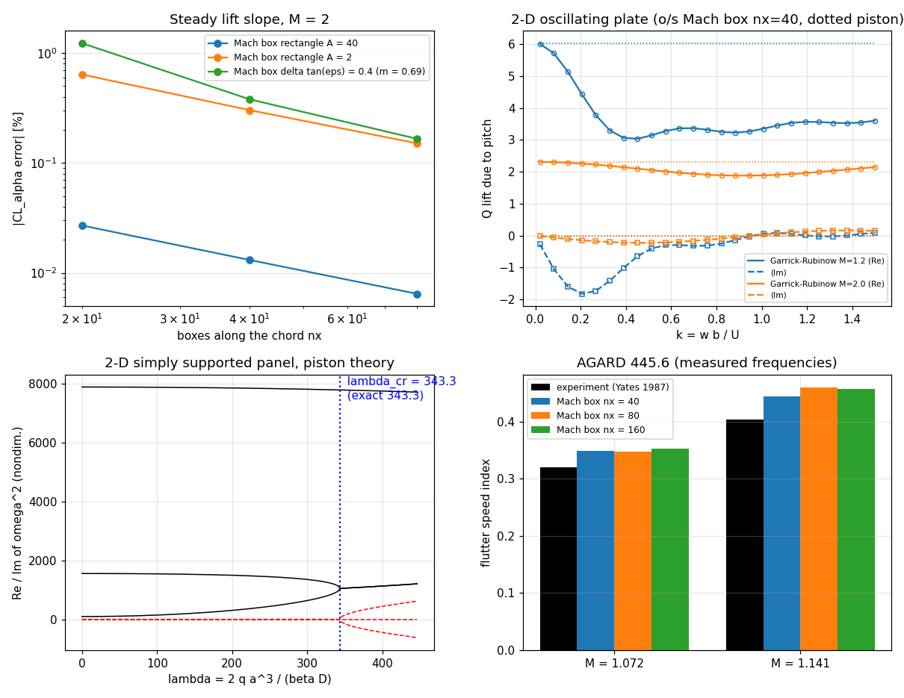

## 7. VLM / UVLM 공력 및 UVLM 플러터 검증

**검증 대상:** `flaap.aero.uvlm`: 정상 VLM, 비선형 시간영역 UVLM (규정/자유 후류), 주파수영역 선형화 UVLM GAF와 그것을 쓴 플러터 (`model uvlm`, `aero_method uvlm`).

**비교 기준 (우선순위 순):**

- **1순위 실험** — 없음 — 비교한 실험 자료 없음.
- **2순위 타 해석** — Goland 날개 플러터: Murua et al. (2012) UVLM, Wang (1999); 직사각형 날개 양력면 해석 값.
- **3순위 해석해** — Helmbold 양력 기울기, 타원익 스팬 효율, Wagner/Küssner 함수, Theodorsen 조화 양력, Garrick 추력.
- **자기일관성 (검증 근거 아님)** — 3-D 충격 출발의 정상 극한, 규정 vs 자유 후류, 주파수영역 vs 시간영역 상태공간.

**판정:** UVLM 플러터 (Richardson 외삽) 167.0 m/s vs Murua UVLM 165.0 m/s (+1.2 %). 해석해 대비: Wagner 최대 1.72 %, Küssner (s >= 4) 1.75 %, Theodorsen 외삽 0.16 %, Garrick 추력 최대 1.59 %.

<!-- summary | VLM / UVLM 공력 및 UVLM 플러터 검증 | 없음 | Murua 2012 (Goland) | Helmbold, Wagner, Theodorsen 등 | 167.0 m/s vs Murua UVLM 165.0 m/s (+1.2 %) -->

### 7.1 [2순위 타 해석] 선형화 UVLM + PK 플러터: Goland 날개 (Murua 2012)

```
7. Goland wing flutter, rho = 1.02 kg/m^3 (4 beam modes)
   references: Murua et al. (2012) UVLM 165.0 m/s, 10.98 Hz; Wang (1999) 163.8 m/s
  linear UVLM  8x12 + PK: V_f =  172.69 m/s, f = 10.634 Hz [0.7 s]
  linear UVLM 16x12 + PK: V_f =  170.04 m/s, f = 10.803 Hz [3.2 s]
  linear UVLM 32x12 + PK: V_f =  168.51 m/s, f = 10.900 Hz [10.6 s]
  linear UVLM, Richardson nc -> inf: V_f           166.9760   165.0000    +1.20 %  Murua UVLM
  DLM 8x12 + PK (same modes):     V_f =  165.11 m/s, f = 11.176 Hz
  discrete-time UVLM state space 8x12 (2988 states): V_f =  173.24 m/s, f = 10.673 Hz [35.0 s]  (time-domain eigenvalues;
   agrees with PK on the same lattice -> the frequency- and time-domain forms are consistent)

total time 308 s
```

### 7.2 [3순위 해석해] 정상 VLM: 양력 기울기, 유도항력

```
1. Steady VLM (horseshoe lattice, Trefftz-plane induced drag)
  case                                                FLAAP        ref       err
  elliptic A = 4, 8x24: CL_alpha [1/rad]             3.7850     3.8832    -2.53 %  Helmbold
  elliptic A = 4, 8x24: span efficiency e            1.0032     1.0000    +0.32 %  lifting line
  elliptic A = 4, 12x48: CL_alpha [1/rad]            3.7599     3.8832    -3.18 %  Helmbold
  elliptic A = 4, 12x48: span efficiency e           1.0001     1.0000    +0.01 %  lifting line
  elliptic A = 8, 8x24: CL_alpha [1/rad]             4.8322     4.9058    -1.50 %  Helmbold
  elliptic A = 8, 8x24: span efficiency e            1.0036     1.0000    +0.36 %  lifting line
  elliptic A = 8, 12x48: CL_alpha [1/rad]            4.8122     4.9058    -1.91 %  Helmbold
  elliptic A = 8, 12x48: span efficiency e           1.0009     1.0000    +0.09 %  lifting line
  A = 1000 strip, 8 chordwise: CL_alpha              6.2748     6.2832    -0.13 %  thin aerofoil 2 pi
  rectangle A = 4, 8x20 : CL_alpha 3.6753, e 0.9918, x_ac/c 0.2326   (lifting surface 3.6-3.7, e 0.98-0.99)
  rectangle A = 4, 8x40 : CL_alpha 3.6436, e 0.9907, x_ac/c 0.2324   (lifting surface 3.6-3.7, e 0.98-0.99)
  rectangle A = 4, 8x80 : CL_alpha 3.6275, e 0.9915, x_ac/c 0.2323   (lifting surface 3.6-3.7, e 0.98-0.99)
```

### 7.3 [3순위 해석해] 비선형 UVLM 지시 응답: Wagner / Küssner

```
2. Indicial lift of a flat plate (nonlinear UVLM, prescribed flat wake, dt = dx/U)
   s = 2Ut/c  Wagner UVLM    exact     err   Kussner UVLM    exact     err
         1.0       0.6109   0.6006  +1.72%         0.4254   0.4167  +2.09%
         2.0       0.6738   0.6693  +0.67%         0.6298   0.5508 +14.34%
         4.0       0.7595   0.7580  +0.21%         0.7067   0.6945  +1.75%
         6.0       0.8132   0.8126  +0.09%         0.7793   0.7731  +0.80%
        10.0       0.8752   0.8750  +0.02%         0.8586   0.8561  +0.29%
        20.0       0.9365   0.9366  -0.01%         0.9318   0.9312  +0.06%
        29.5       0.9582   0.9584  -0.02%         0.9562   0.9559  +0.02%
  (Wagner nc = 20, Kussner nc = 12.  The UVLM sees the gust front panel by panel, so the
   Kussner rise while the front crosses the chord (s <= 2) is discretised: up to +14 % at
   s = 2, where the front reaches the trailing edge; within 2 % for s >= 4.)
```

### 7.4 [3순위 해석해] 조화 피치·플런지: Theodorsen 양력, Garrick 추력

```
3. Harmonic pitch about c/4 (theta0 = 1 deg), |CL| / |CL_Theodorsen| and phase error
  k = 0.10, nc = 12: |CL| 0.09318 (Theodorsen 0.09295), ratio 1.0025, phase error +0.46 deg
  k = 0.50, nc =  8: |CL| 0.08498 (Theodorsen 0.07996), ratio 1.0628, phase error +0.71 deg
  k = 0.50, nc = 16: |CL| 0.08253 (Theodorsen 0.07996), ratio 1.0321, phase error +0.38 deg
  k = 0.50, nc = 32: |CL| 0.08127 (Theodorsen 0.07996), ratio 1.0164, phase error +0.19 deg
  k = 0.50: Richardson (1st order) nc -> inf: ratio 1.0006
  k = 1.00, nc =  8: |CL| 0.12366 (Theodorsen 0.11151), ratio 1.1090, phase error -3.20 deg
  k = 1.00, nc = 16: |CL| 0.11787 (Theodorsen 0.11151), ratio 1.0571, phase error -1.66 deg
  k = 1.00, nc = 32: |CL| 0.11477 (Theodorsen 0.11151), ratio 1.0293, phase error -0.86 deg
  k = 1.00: Richardson (1st order) nc -> inf: ratio 1.0016

4. Harmonic plunge h0 = 0.05 b: lift and mean thrust vs Theodorsen / Garrick (nc = 12)
      k  |CL| ratio    C_T UVLM  C_T Garrick      err
   0.10      1.0025  5.6658e-05   5.6689e-05   -0.05%
   0.25      1.0151  2.5181e-04   2.5228e-04   -0.19%
   0.50      1.0488  7.4500e-04   7.4660e-04   -0.22%
   0.75      1.0771  1.4406e-03   1.4460e-03   -0.37%
   1.00      1.0902  2.3267e-03   2.3644e-03   -1.59%
```

### 7.5 [3순위 해석해] 선형화 UVLM GAF vs Theodorsen

```
5. Linearised UVLM (frequency domain) vs Theodorsen: max relative error of the
   plunge/pitch lift GAFs (wake 60 chords)
    nc   k = 0.1   k = 0.5   k = 1.0
     8     1.28%     5.32%     6.96%
    16     0.67%     2.68%     3.55%
    32     0.36%     1.34%     1.80%
  first-order convergence in nc (the same discrete wake/time-step model as the UVLM).
```

### 7.6 [자기일관성 (검증 근거 아님)] 3-D 충격 출발: 정상 VLM 극한, 규정 vs 자유 후류

```
6. 3-D rectangular wing A = 4 (6x10), alpha = 5 deg, impulsive start
  prescribed wake: CL(15 c) = 0.3249 (99.6 % of steady VLM 0.3261), CD = 0.00812 (Trefftz CDi 0.00846), CL(0+) = 0.2883  [7.5 s]
  free wake: CL(15 c) = 0.3248 (99.6 % of steady VLM 0.3261), CD = 0.00812 (Trefftz CDi 0.00846), CL(0+) = 0.2883  [30.0 s]
  As in Katz & Plotkin (2001, ch. 13), the 3-D lift builds up faster than Wagner's 2-D
  function and reaches the steady VLM value; the free wake (roll-up) changes the lift by
  < 0.1 % at this incidence (prescribed / free wakes give the same loads to 4 digits).
```

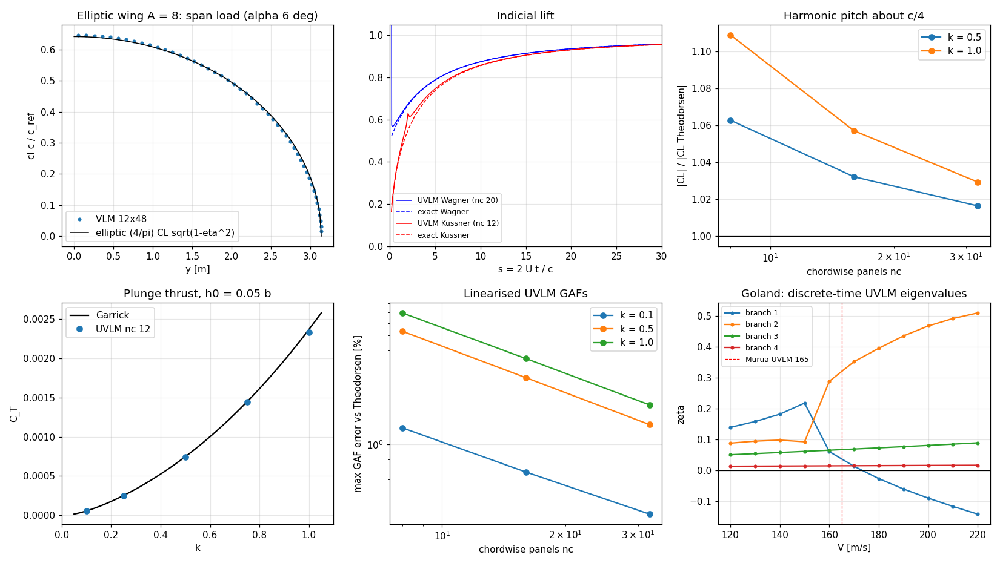

## 8. 조종면 프리플레이 비선형 LCO 검증

**검증 대상:** `flaap.nonlinear`: 조종면 프리플레이의 한계 사이클 진동(LCO) — 기술함수(DF)법과 구간선형 시간 적분, 분기도·이력 현상.

**비교 기준 (우선순위 순):**

- **1순위 실험** — LCO 진폭 미비교 — Conner et al. (1997) 시험 장치(프리플레이 +-3.57 deg, 측정 감쇠 행렬, 5차 피치 강성 다항식)는 FLAAP 모델과 달라 비교하지 않음.
- **2순위 타 해석** — Vasconcellos et al. (2016) 선형 플러터 속도 (프리플레이 없음, 9.2 m/s).
- **3순위 해석해** — 없음.
- **자기일관성 (검증 근거 아님)** — DF vs 시간 적분 (진폭·진동수), 진폭의 delta0 비례성, 상·하향 속도 스윕 이력, Goland + 플랩 3-D 모델의 DF vs 시간 적분.

**판정:** 선형 플러터 속도 9.23 m/s vs 9.2 m/s. 자기일관성: DF vs 시간 적분 LCO 진폭 최대 3.8 %, 진동수 1.5 %.

<!-- summary | 조종면 프리플레이 비선형 LCO 검증 | 미비교 (공백) | Vasconcellos 2016 V_f | 없음 | V_f 9.23 m/s vs 9.2 m/s -->

### 8.1 [2순위 타 해석] Conner/Vasconcellos 3자유도 단면: 선형 플러터 속도

| | V_f [m/s] |
|---|---|
| FLAAP (Jones-Wagner RFA, Conner 감쇠) | 9.232 |
| Vasconcellos et al. (2016) | 9.2 |
| 오차 | +0.3 % |

### 8.2 [자기일관성 (검증 근거 아님)] 기술함수 vs 시간 적분, 분기도 (단면 / Goland + 플랩)

```
linear flutter speed (K = K_beta): 9.232 m/s   (published 9.2 m/s)
flutter speed with K = 0         : 3.052 m/s
DF stable LCO branch from        : 1.88 m/s (subcritical fold)

  V     kind   A_TM/d0  A1_TM/d0  A_DF/d0   err_A   w_TM    w_DF    err_w  pitch[deg] h[mm]
  3.5  lco      1.195    1.053    1.153   +3.7%   15.26   15.33   -0.5%    0.481    0.30
  5.0  lco      1.204    1.059    1.160   +3.8%   15.65   15.72   -0.5%    0.907    0.45
  7.0  lco      1.227    1.075    1.183   +3.7%   16.33   16.42   -0.6%    1.749    0.44
  8.5  lco      1.369    1.150    1.328   +3.1%   17.38   17.64   -1.5%    2.794    0.65

bifurcation sweep (time marching, continuation):
  V     up: kind  A/d0     down: kind  A/d0
  1.0   decay      0.000   decay      0.000
  1.5   decay      0.000   decay      0.000
  2.0   decay      0.000   lco        1.162
  2.5   decay      0.000   lco        1.180
  3.0   decay      0.117   lco        1.189
  3.5   lco        1.195   lco        1.195
  4.0   lco        1.199   lco        1.199
  4.5   lco        1.202   lco        1.202
  5.0   lco        1.204   lco        1.204
  5.5   lco        1.206   lco        1.206
  6.0   lco        1.209   lco        1.209
  6.5   lco        1.215   lco        1.215
  7.0   lco        1.227   lco        1.227
  7.5   lco        1.248   lco        1.248
  8.0   lco        1.288   lco        1.288
  8.5   lco        1.369   lco        1.369
  9.0   lco        1.593   lco        1.593
  9.5   growing      -     growing      -  

amplitude scaling (delta0 = 2 deg vs 1 deg):
  V =  4.0 m/s: flap ratio 2.0000, pitch ratio 2.0000
  V =  7.0 m/s: flap ratio 2.0000, pitch ratio 2.0000
below the fold: V=1.50 A0=1.5d0 -> decay, V=1.50 A0=4.0d0 -> decay, V=1.50 A0=10.0d0 -> decay
preloaded freeplay (gap centre 0.5 delta0) at 6 m/s: lco, amplitude 0.747 d0, mean 0.027 deg
preloaded freeplay (gap centre 1.5 delta0) at 6 m/s: decay, amplitude 0.000 d0, mean 0.445 deg
timing: DF 0.84 s (85 speeds), TM 2.55 s (4 x 80 s), sweeps 15.3 s
```

```
Goland wing + 50-83 % span flap (hinge 75 % c), zeta = 1 %, delta0 = 0.5 deg
K_h = 9340.3 N m/rad, I_h = 0.2548 kg m^2, omega_flap = 191.45 rad/s
V_f(K): 0.00K_h:142.5, 0.02K_h:145.4, 0.05K_h:148.0, 0.10K_h:150.4, 0.20K_h:152.8, 0.40K_h:154.6, 0.70K_h:155.6, 1.00K_h:156.0
DF: V_f0 = 142.50 m/s, V_f(K_h) = 155.95 m/s
  V      kind   A_TM/d0  A_DF/d0   w_TM    w_DF
 140.0  decay    0.161      nan   78.33     nan
 145.0  lco      1.066    1.062   76.48   76.49
 150.0  lco      1.262    1.220   74.27   74.38
 153.0  lco      1.723    1.487   72.44   72.79
timing: build 3.7 s, DF 0.93 s, TM 1.8 s (4 x 8 s)

figures: freeplay_bifurcation.png, freeplay_time_history.png, freeplay_phase_plane.png, freeplay_keq.png, goland_freeplay_lco.png
total runtime 30.1 s
```

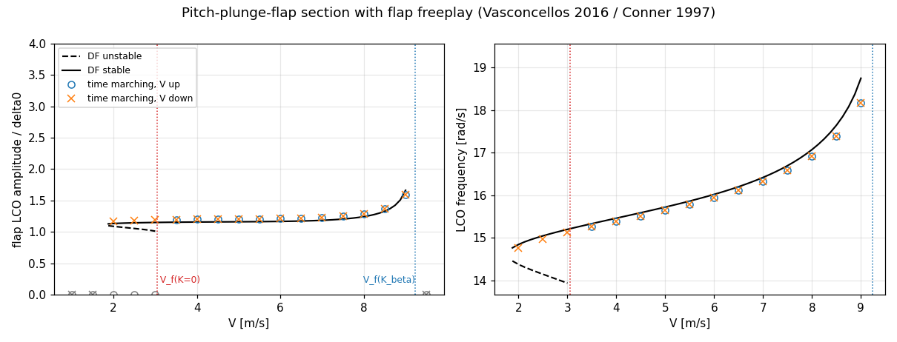

## 9. 공력서보탄성 (ASE) 플러터 억제·돌풍하중 완화 — 자기일관성 검사

**검증 대상:** `flaap.ase`: 작동기/센서/제어 법칙을 포함한 폐루프 플러터, 이득·위상 여유, Nyquist, GLA.

**비교 기준 (우선순위 순):**

- **1순위 실험** — 없음.
- **2순위 타 해석** — 없음 — 같은 제어 법칙의 문헌 결과 없음.
- **3순위 해석해** — 없음.
- **자기일관성 (검증 근거 아님)** — 이득 0 = 개루프 플러터, Nyquist vs 고유값, 이득 여유 x0.97/x1.03에서 근 교차 확인.

**판정:** K = 0 폐루프 V_f 9.2450 = 개루프 p-method 9.2450 m/s; Nyquist 판정과 폐루프 고유값 판정 모든 속도에서 일치 (6점). 제어 법칙 A/B로 V_f +40 / +88 %.

<!-- summary | 공력서보탄성 (ASE) 플러터 억제·돌풍하중 완화 — 자기일관성 검사 | 없음 | 없음 | 없음 | 자기일관성만 -->

### 9.1 [자기일관성 (검증 근거 아님)] Conner/Vasconcellos 단면 플러터 억제

```
open-loop p-method (AeroelasticSystem.flutter): V_f = 9.2450 m/s, f = 3.363 Hz
ASE closed loop with K = 0:                     V_f = 9.2450 m/s (bisection 9.2440)
law A: pitch + pitch rate        gains [-1.   -0.03  0.    0.  ]: V_f = 12.971 m/s (+40.3 %)
law B: full output feedback      gains [  1.6    0.16 -18.    -2.3 ]: V_f = 17.402 m/s (+88.2 %)

margins, law B (GM in dB; lower = gain reduction that destabilises):
   V    P  N_ccw  Nyquist  eig     GM_low   GM_up     PM[deg] @w[rad/s]  GM check
  5.0   0     0   True    True       -inf      inf     78.10 @  19.50   None
  9.0   0     0   True    True      -3.05      inf     20.12 @  24.63   True
 12.0   2     2   True    True      -3.62      inf     62.40 @  44.81   True
 15.0   2     2   True    True      -4.74      inf     18.58 @  13.59   True
 17.0   2     2   True    True      -0.83      inf      0.94 @   5.89   True
 18.0   2     1   False   False      -inf      inf     36.00 @  77.41   None
timing: flutter 0.8 s, margins 0.5 s
```

### 9.2 [자기일관성 (검증 근거 아님)] Goland + 플랩 돌풍하중 완화 (GLA)

```
GLA, Goland + flap: root-bending strain-gauge feedback k = -2.0e-06 rad/(N m), V = 100.0 m/s, Uds = 5.0 m/s
   H[m]   Mx open    Mx GLA   change   Fz open   Fz GLA   change   flap[deg]
   5.0      48208     42152   -12.6%     14183    13009    -8.3%    4.54
  15.0      47750     35783   -25.1%     16464    13380   -18.7%    3.80
  30.0      46700     35847   -23.2%     16551    13671   -17.4%    3.79
flutter: open 159.67 m/s, ASE K = 0 159.67 m/s, with GLA 174.77 m/s
GLA loop at 100 m/s: P = 0 unstable open-loop poles, N_ccw = 0 -> stable (Nyquist), eigenvalues: stable; gain margins: upper +6.51 dB @ 58.91 rad/s, lower -inf dB; phase margin: inf deg @ nan rad/s
timing: build 2.9 s, gust runs 0.1 s

figures: ase_vg_rootlocus.png, ase_bode_nyquist.png, ase_gla_goland.png
total runtime 6.4 s
```

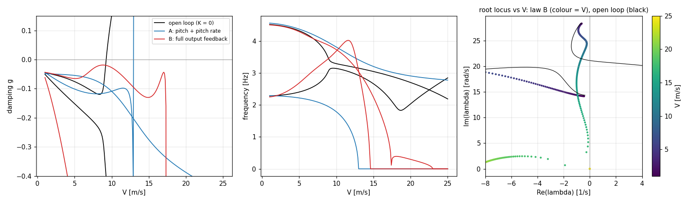

## 10. 돌풍 응답 검증 (1-cos 이산 돌풍) — 자기일관성 검사

**검증 대상:** `flaap.gust`: RFA 상태공간 시간영역 돌풍 응답.

**비교 기준 (우선순위 순):**

- **1순위 실험** — 없음.
- **2순위 타 해석** — 없음.
- **3순위 해석해** — 없음.
- **자기일관성 (검증 근거 아님)** — 같은 GAF 표의 주파수영역 해 (표 보간 GAF + FFT) 와 비교.

**판정:** 주요 모드 1/2 최대 응답 TD vs FD 차이 -0.13 / -0.12 %.

<!-- summary | 돌풍 응답 검증 (1-cos 이산 돌풍) — 자기일관성 검사 | 없음 | 없음 | 없음 | TD vs FD 일치 -->

### 10.1 [자기일관성 (검증 근거 아님)] Goland 날개: 시간영역 (RFA) vs 주파수영역 (GAF + FFT)

1-cos 돌풍 H = 20 m, U = 10 m/s, V = 100 m/s, zeta = 2 %

| output | TD max | FD max | TD min | FD min |
|---|---|---|---|---|
| eta:mode1 | 5.7520e-03 | 6.1005e-03 | -5.9492e-01 | -5.9571e-01 |
| eta:mode2 | 3.6325e-04 | 3.1116e-04 | -1.5842e-01 | -1.5861e-01 |
| eta:mode3 | 7.9504e-06 | 4.5738e-06 | -9.1545e-03 | -9.1642e-03 |
| eta:mode4 | 1.0514e-02 | 1.0524e-02 | -2.1055e-06 | 4.5819e-08 |

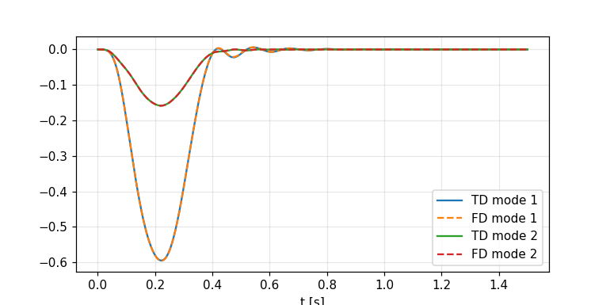

## 11. 정적 공탄성 트림·기동하중 — 자기일관성 검사

**검증 대상:** `flaap.trim`, `flaap.maneuver`, `flaap.loads`: 유연 기체 1-g 트림, CS-25.331(c)(2) 점검 피치 기동, 모니터 단면 하중.

**비교 기준 (우선순위 순):**

- **1순위 실험** — 없음.
- **2순위 타 해석** — 없음 — 시연 기체 (기준 해 없음).
- **3순위 해석해** — 없음.
- **자기일관성 (검증 근거 아님)** — 트림 양력 = 반 기체 무게, 기동 중 n_z 한계 도달.

**판정:** 트림 양력 6057.5 N = 반 무게 6057.5 N (상대차 0.0e+00); 기동 n_z 최대 2.50 (한계 2.5).

<!-- summary | 정적 공탄성 트림·기동하중 — 자기일관성 검사 | 없음 | 없음 | 없음 | 자기일관성만 -->

### 11.1 [자기일관성 (검증 근거 아님)] 시연 유연 기체

1-g 트림 V = 100.0 m/s: alpha = 0.941 deg, 승강타 = -0.501 deg, 양력 = 6057.5 N (반 무게 6057.5 N), 뿌리 하중 root.Fz = 3976.0, root.Mx = 9966.9, root.My = -2395.6

단주기: wn = 8.06 rad/s, zeta = 0.936. n_z = 2.5 점검 기동: 승강타 최대 2.43 deg, 뿌리 Fz 증분 (FSM) 5942 N, Mx 14126 N m

자유 비행 플러터 (p-method):     flutter  mode  2  V =   161.495 m/s  f =   11.220 Hz (  70.499 rad/s)  k =  0.3992

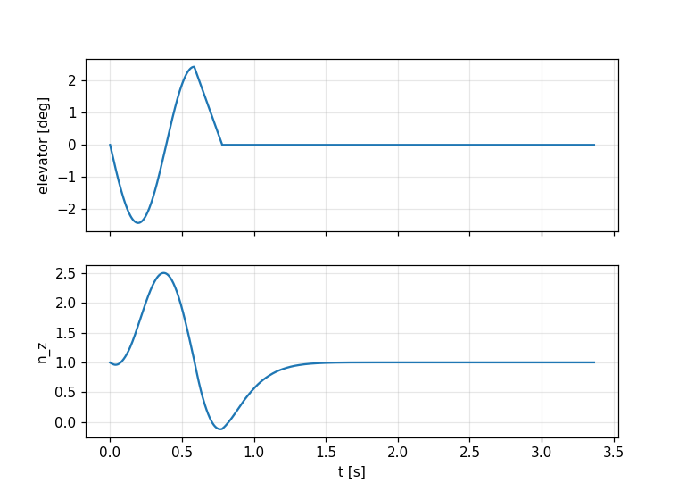

## 12. 실험 비교가 없는 항목 (향후 과제)

| 기능 | 현재 최상위 기준 | 필요한 실험/자료 |
|---|---|---|
| 양력 TSD 충격파 위치 (5장) | 타 해석 (AGARD-AR-211 Euler) | NACA 0012 등 천음속 2-D/3-D 풍동 압력 분포 (벽·점성 보정 고려) |
| 받음각이 있는 천음속 플러터 (5.4) | 없음 (경향) | 평균 받음각을 바꾼 천음속 플러터 시험 |
| TSD 천음속 플러터 (4장) | 실험 있음; 타 해석 미비교 | 문헌 CAP-TSD / Euler AGARD 445.6 결과 |
| 스트립 이론·UVLM 플러터 (3, 7장) | 타 해석 | 3-D 날개 플러터 풍동 시험 (예: AGARD 445.6 저 Mach로 UVLM 비교) |
| 프리플레이 LCO 진폭 (8장) | 자기일관성 | Conner (1997) 시험 장치 그대로의 모델 (+-3.57 deg, 비선형 강성) |
| ASE, 돌풍, 트림·기동 (9-11장) | 자기일관성 | 시험 또는 독립 코드 (예: NASTRAN SOL 144/146) 결과 |
